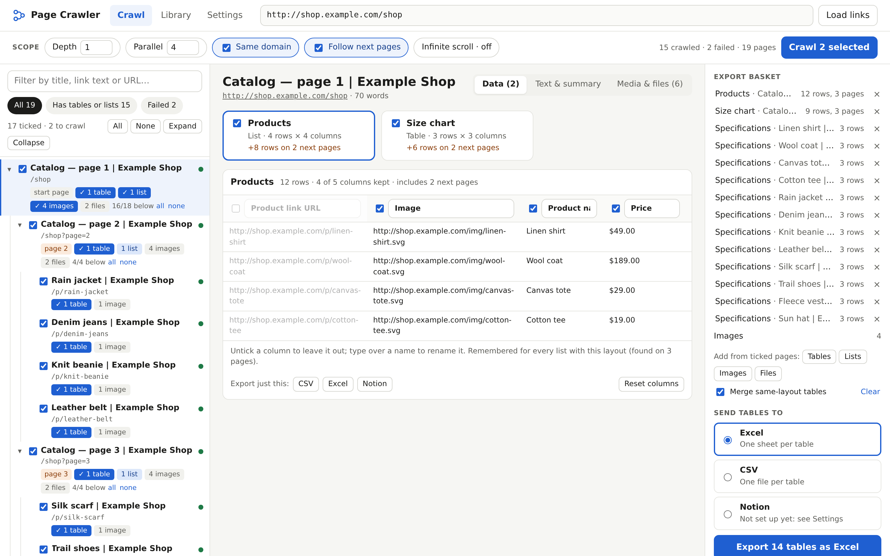
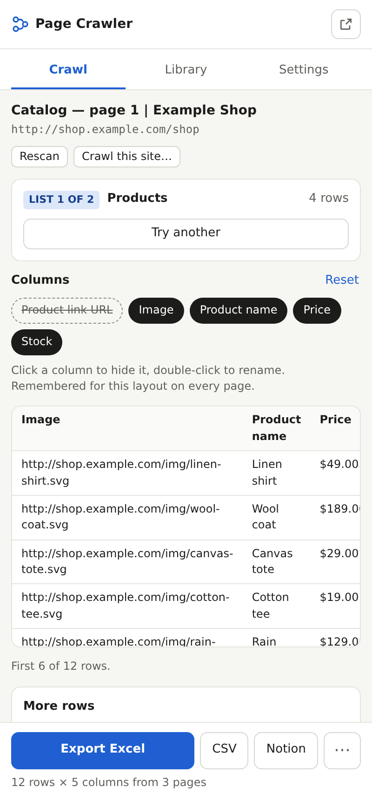
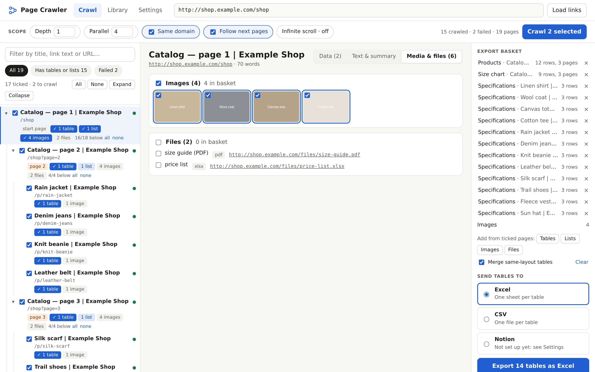
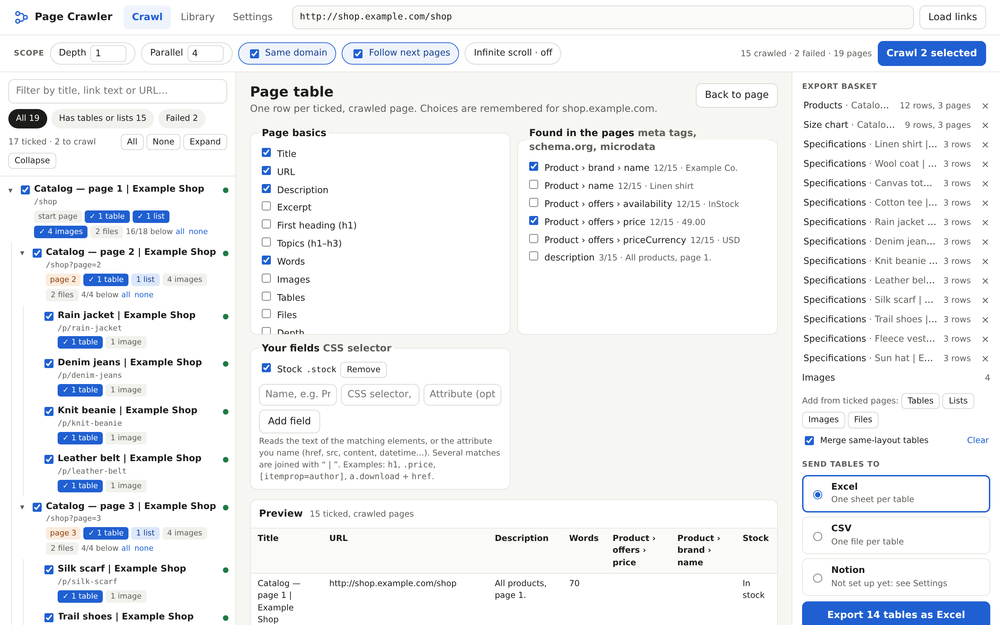
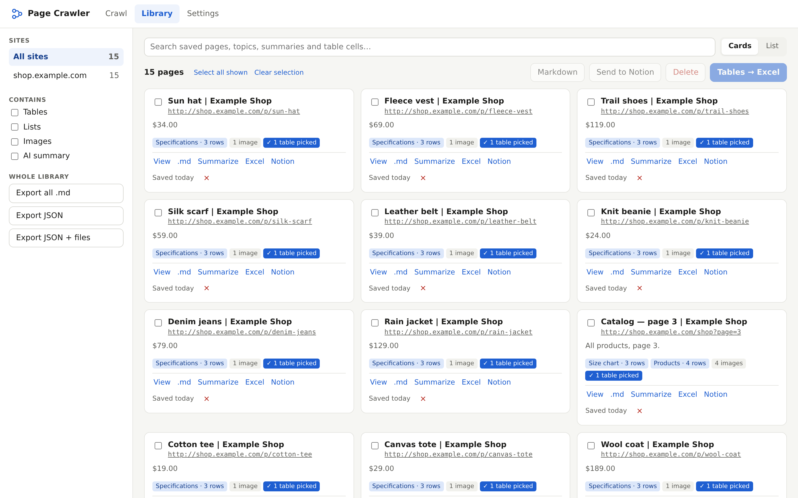
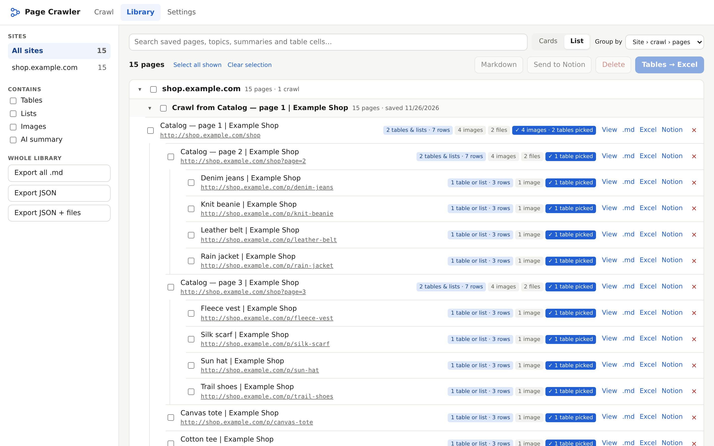
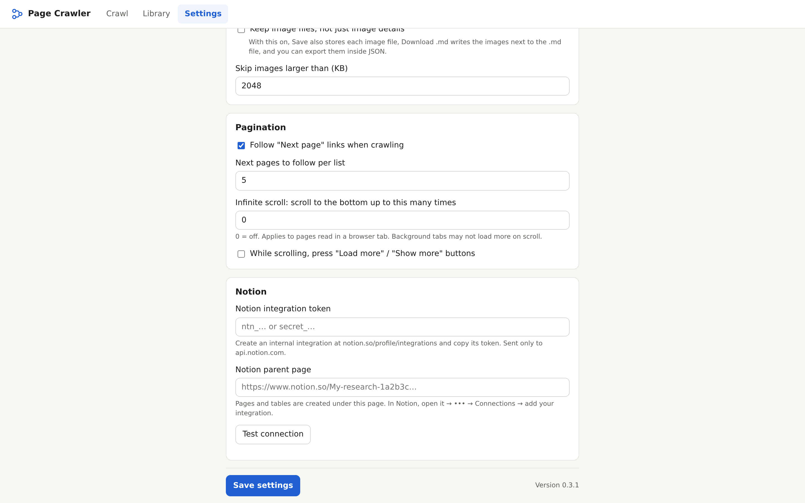

# Page Crawler & Summarizer

A Chrome extension that pulls the data out of web pages. Grab the table or list on the page you're
on in one click, or crawl a whole site's links. Export to **Excel, CSV, Markdown, JSON or Notion**,
keep pages in a local **library**, and summarize them with **Claude**.

Everything runs in your browser. There's no account, no server and no usage meter: pages are stored
locally, and the only things that leave your machine are the requests you ask for (to Anthropic for
summaries, to Notion for exports).



## Contents

- [Features](#features)
- [Install](#install)
- [Quick start](#quick-start)
- [The side panel](#the-side-panel)
- [The full view](#the-full-view)
- [The library](#the-library)
- [Settings](#settings)
- [Set up Claude summaries](#set-up-claude-summaries)
- [Set up Notion](#set-up-notion)
- [Where your data and files go](#where-your-data-and-files-go)
- [Troubleshooting](#troubleshooting)
- [Limits](#limits)
- [Develop](#develop)
- [License](#license)

## Features

**Get data from a page**
- **Automatic table and list detection.** HTML tables are read with their header row. Repeating blocks
  (product cards, search results, directory entries, job posts) are turned into rows and columns
  automatically. See [What is a “list”?](#what-is-a-list)
- **Choose columns.** Hide and rename columns. Your choices are remembered for that layout on every page.
- **Pagination and infinite scroll.** Follow “Next” links so a list spread over several pages exports as
  one; scroll pages to the bottom and press “Load more” buttons.
- **Structured fields.** Meta tags, schema.org JSON-LD (e.g. `Product › offers › price`) and microdata are
  read from each page, and you can add your own fields with a CSS selector.
- **Images and files.** Images in the page's content and links to PDFs, Office documents, CSV, ZIP and
  media files are listed and can be downloaded.

**Crawl a site**
- A tree of the start page's links, crawled up to 5 levels deep, with same-domain filtering, a parallel
  limit, and pages that need JavaScript or a sign-in loaded in a background tab with your session.
- Duplicate pages (redirects, identical content, same canonical address) are detected and linked, not crawled twice.
- Links that look like sign-out, delete or approve actions are never ticked automatically.

**Export and keep**
- **Excel** (`.xlsx`, one sheet per table, numbers stored as numbers), **CSV**, **Markdown** (with front
  matter, tables and local copies of images), **JSON**, and **Notion** (pages and databases).
- Same-layout tables from different pages merge into one sheet with a Page URL column.
- A **library** of saved pages with cards and a list view (by site and crawl, or by category), search
  across text, summaries and table cells, and bulk export.
- **Pick** specific images, files and tables on a page; they're saved and exported with its text.
- **Claude summaries** of any page, with your own API key.

## Install

The extension isn't in the Chrome Web Store. Load it from this folder; no build step is needed because the
built extension is included in `dist/`.

1. Download or clone this repository.
2. In Chrome, open `chrome://extensions` and turn on **Developer mode** (top right).
3. Click **Load unpacked** and choose the **`dist`** folder.
4. Click the puzzle-piece icon in the toolbar and **pin** Page Crawler, so its icon is always visible.

Works in Chrome 116 or later and other Chromium browsers with side-panel support (Edge, Brave).

**Updating:** replace the folder's contents with the new version, then press **↻** on Page Crawler in
`chrome://extensions`. Close and reopen the side panel and any full-view tabs afterwards. The version
number is shown at the bottom of the Settings tab.

> Keep the folder in the same place: Chrome derives the extension's ID from the folder path, and your
> library and settings belong to that ID. See [Troubleshooting](#troubleshooting).

## Quick start

1. Open any page with a table or a list of items, e.g. a product catalog.
2. Click the **Page Crawler** icon. The side panel opens beside the page with its biggest table or list.
3. Click a column to hide it, double-click to rename it.
4. Press **Export Excel**. The file lands in `Downloads/page-crawler/<site>/tables/`.

To crawl the site instead, press **Crawl this site…** in the panel.

## The side panel



The default view. It follows the active tab and has three tabs: **Crawl**, **Library** and **Settings**.

**Crawl tab: the page you're on**
- The biggest table or list on the page, labelled e.g. **LIST 1 OF 2**. **Try another** steps through the
  others; **Also on this page** lists them too.
- **Columns**: click a chip to hide that column, double-click to rename it. **Reset** undoes your changes.
- **Preview** of the first rows, with the total below.
- **More rows**
  - **Follow “Next” link** loads the list's next pages (up to the limit in Settings) and adds their rows.
    Shows *found* when the page has a next link.
  - **Scroll to load more** scrolls the tab to the bottom, presses “Load more” buttons, and reads it again.
- **Also on this page**: other tables and lists, **Images** and **Files** (each with **Download**), and the
  page's structured data.
- **Export Excel**, **CSV**, **Notion**, and **⋯** for *Copy table* (paste into Excel or Google Sheets),
  *Save page to library* and *Download page as .md*.
- **Rescan** reads the page again; **Crawl this site…** opens the full view on this page.

**Stopping a job.** Long jobs (downloading images or files, sending to Notion, loading next pages) show a
bar under the tabs with a **Stop** button. It stops before the next item and cancels downloads still in
progress; what's already done stays.

**Library tab**: saved pages grouped by site, with search, `.md` and Excel downloads. **Full library**
opens the full view's library.

**Settings tab**: the same settings as the full view.

<br clear="right">

## The full view

Opens in its own browser tab from the side panel (**Open full view** ↗ at the top, or **Crawl this site…**).
You can also type a start address into its address bar and press **Load links**.

It has the same three tabs. The **Crawl** tab has three panes: the pages on the left, the page you chose in
the middle, and the export basket on the right (see the screenshot at the top).

### Scope bar

| Control | What it does |
|---|---|
| **Depth** | Link hops from the start page. 1 = only the links on the start page; 2 = also the links on those pages; up to 5. |
| **Parallel** | Pages loaded at the same time, 1–10 (default 4). Pages that need a browser tab are limited to 2 at once. |
| **Same domain** | Show and crawl only links on the start page's site. |
| **Follow next pages** | Add each crawled page's “Next page” link as page 2, 3… without using up depth. |
| **Infinite scroll** | Shows the scroll setting; click to change it in Settings. |
| **Crawl selected** | Loads the ticked pages that aren't crawled yet. **Stop** appears while it runs. |

### Pages (left)

- The start page at the top, each page's links underneath it. Each page shows its address, a status dot
  (green = crawled, red = failed, hollow = loading, grey = queued) and tags for what was found.
- **Tick** pages to crawl them and to include them in the bulk actions. **all** / **none** under a page tick
  or untick everything below it.
- **Filter** by text, or show only **Has tables or lists** or **Failed** pages.
- **+N links**: a page at the depth limit has more links; click to add them and pick some by hand.
- **↪ same page** rows are duplicates of a page already in the tree; **Go to original** jumps to it.
- **Click a page's title** to show it in the middle pane.

**Picking from the tags.** The tags **1 table**, **1 list**, **4 images** and **2 files** are buttons. Click
one to pick all of those on that page: it adds them to the export basket, ticks the page, and opens it on the
right tab, where you can untick single items. A partly picked tag reads “3 of 4 images”; click again to drop
them. When you save the page, **what you picked is saved with it** (see [The library](#the-library)).

### The chosen page (middle)

- **Data**: a card for each table and list (tick = add to the basket). The open one is shown as a grid:
  untick a column to leave it out, type over a column name to rename it, or **Reset columns**. **Export just
  this** sends the one table to CSV, Excel or Notion.
- **Text & summary**: **Save to library**, **Download .md**, **Summarize & save**, **View full Markdown**, the
  page's topics (its headings) and its Markdown.
- **Media & files**: image thumbnails and file links, each with a checkbox.



### Export basket (right)

- The tables and lists you ticked, each with its row count (including its next pages) and **×** to remove it.
  Click one to show it.
- **Add from ticked pages**: add every **Tables**, **Lists**, **Images** or **Files** on the ticked pages at once.
- **Merge same-layout tables**: same-shaped tables from different pages go into one sheet with a Page URL column.
- **Send tables to** **Excel** (one sheet per table), **CSV** (one file per table) or **Notion** (one database
  per table), then **Export**. **Download images & files** saves the picked images and files.
- **Ticked pages**: **Save to library**, **Download as .md**, **Summarize with Claude**, **Send pages to
  Notion** (a Notion page each, with content, summary and tables), and **Page table…**.

### Page table

One row per ticked page, with the columns you choose:
- **Page basics**: title, URL, description, excerpt, headings, word count, image/table/file counts, depth,
  parent page, AI summary.
- **Found in the pages**: meta tags, schema.org JSON-LD and microdata, with how many pages have each field and
  a sample value.
- **Your fields**: a name and a CSS selector (e.g. `.price`, `[itemprop=author]`), optionally with an
  attribute to read (`href`, `src`, `content`, `datetime`…).

Choices are remembered per site. Export with **CSV**, **Excel** or **Notion**.



### What is a “list”?

A **list** is data a page shows as repeated blocks with the same layout rather than as an HTML `<table>`:
product cards, search results, directory entries, article teasers. The extension finds groups of at least 3
blocks built the same way. Each block becomes a **row**; each spot inside it (title, price, link, image)
becomes a **column**.

- Column names come from the page's code (e.g. “Product link URL”), so rename them as you like.
- Repeats inside navigation, headers, footers and sidebars are skipped, and spots that fewer than 10% of the
  blocks have are dropped.
- It's a best guess: if the wrong thing is picked, use **Try another** or another card under **Data**.

## The library

Saved pages, in the **Library** tab of either view. Filter by **site**, by what pages **contain** (tables,
lists, images, AI summary), or **search** titles, summaries, topics and table cells.

**Cards** show each page with its summary, its tables, and what was picked when it was saved:



**List** groups pages, by either:
- **Site › crawl › pages**: each site, each crawl in it, and pages nested under the page that linked to them.
- **Category**: Tables & lists, Summarized, With images, With file links, Text only.

Groups fold, and a group's checkbox selects every page in it.



**Actions**
- Per page: **View** (the Markdown), **.md**, **Summarize**, **Excel** (its tables), **Notion**, **×** delete.
- On selected pages: **Markdown**, **Send to Notion**, **Delete**, **Tables → Excel** (one workbook).
- Whole library: **Export all .md**, **Export JSON**, **Export JSON + files** (stored images and picked files
  as base64 `data:` URLs).

**Picked items.** If you picked images, files or tables on a page before saving it, the library shows
“✓ 3 images · 1 file picked”. The picked image files and files (up to 50 MB each) are stored with the page.
Its `.md` download then includes *Picked images* and *Picked files* sections and writes those files to a
`<page>_files/` folder next to the `.md`, with links to the local copies.

## Settings

In the **Settings** tab of either view (Chrome's *Options* entry for the extension opens it too).
Press **Save settings** after changing anything.



| Setting | Default | What it does |
|---|---|---|
| Anthropic API key | — | Needed for summaries. Sent only to api.anthropic.com. |
| Summary model | Claude Opus 5.5 | Opus (best), Sonnet (balanced) or Haiku (cheapest, fastest). |
| Max pages per crawl | 50 | A crawl stops here; press **Crawl selected** again to continue. |
| Pages fetched in parallel | 4 | Same as **Parallel** on the Crawl tab. |
| Show only same-domain links | on | Default for **Same domain**. |
| Default crawl depth | 1 | Default for **Depth**. |
| Name pages by | Document title | `<title>`, the first `<h1>`, or `og:title`. Used in the tree, library and file names. |
| Load pages by | Automatic | *Automatic*: fetch first, use a background tab if the page comes back nearly empty or needs sign-in. *Fetch only*: fastest, no JavaScript. *Always a browser tab*: slowest, sees everything you see. |
| Keep image files | off | Store every image file when saving a page, not just its details. Picked images are always stored. |
| Skip images larger than | 2048 KB | |
| Follow “Next page” links | on | Default for **Follow next pages**. |
| Next pages to follow per list | 5 | |
| Infinite scroll | 0 (off) | Scroll pages read in a tab to the bottom up to this many times. |
| Press “Load more” buttons | off | While scrolling. |
| Notion integration token | — | See [Set up Notion](#set-up-notion). Sent only to api.notion.com. |
| Notion parent page | — | The Notion page exports are created under. |

## Set up Claude summaries

1. Create an API key at [console.anthropic.com](https://console.anthropic.com) (API usage is billed by Anthropic).
2. Paste it into **Settings → Anthropic API key** and press **Save settings**.
3. Use **Summarize & save** on a page (Text & summary tab), **Summarize with Claude** for ticked pages, or
   **Summarize** in the library. Summaries are saved with the page and included in its Markdown.

## Set up Notion

1. Go to [notion.so/profile/integrations](https://www.notion.so/profile/integrations), create an **internal
   integration** in the **same workspace** as the page you'll export to, and copy its token (`ntn_…`).
2. In Notion, open the page exports should go under, then **•••** (top right) → **Connections** → find your
   integration → **Confirm**.
3. In **Settings → Notion**, paste the token and the page's link (any form works, e.g.
   `https://www.notion.so/My-page-1a2b…` or `https://app.notion.com/p/My-page-1a2b…`).
4. Press **Test connection**. It shows the integration's name and workspace and whether it can see the page.
5. Press **Save settings**.

Then:
- A **table or list** sent to Notion becomes a **database** under that page: the first column is the title,
  columns of web addresses become URL properties, the rest text.
- A **page** sent to Notion (**Send pages to Notion**, or **Notion** in the library) becomes a Notion page
  with a link to the original, the summary, the content, and its tables.

## Where your data and files go

| What | Where |
|---|---|
| Saved pages (text, topics, summary, tables, lists, file links, structured fields, picked items) | IndexedDB in your Chrome profile, database `page-crawler`, store `pages` |
| Stored image files and picked files | IndexedDB store `images` |
| Settings, API key, Notion token, column choices, page-table fields, library view | `chrome.storage.local` |
| Markdown downloads | `Downloads/page-crawler/<site>/<page>.md`, files in `<page>_files/` |
| CSV and Excel exports | `Downloads/page-crawler/<site>/tables/` |
| Downloaded images and files | `Downloads/page-crawler/<site>/<page>_resources/` |
| Library exports | `Downloads/page-crawler/library-<date>.md` / `.json` |

Saved data survives browser restarts and is deleted only when the extension is removed. To look at it, open
the full view and press **F12 → Application → IndexedDB**.

**Privacy.** Pages are read with your own browser session: fetches send your cookies for the site, and
pages that need JavaScript or a sign-in are opened in a background tab and closed again. Nothing is sent
anywhere else, except page text to Anthropic when you summarize, and exports to Notion when you send them.
Page content sent to Claude is untrusted input; review summaries of pages you don't trust.

## Troubleshooting

**Clicking the icon opens a new tab instead of the side panel.** Chrome is still running an older version.
Press **↻** on Page Crawler in `chrome://extensions` and check the version at the bottom of the Settings tab.

**The side panel says it can't read the page.** Chrome doesn't let extensions read its own pages (new tab,
settings, `chrome://`, the Web Store). Open a normal web page.

**A crawled page is empty or shows a sign-in page.** Set **Load pages by** to *Automatic* or *Always a
browser tab*, and make sure you're signed in to that site in this browser.

**“Notion can't see the parent page.”** Press **Settings → Notion → Test connection**. Usually the
integration isn't connected to the page (step 2 of [Set up Notion](#set-up-notion)), or it was created in a
different workspace from the page. Company workspaces can also block integrations; ask an admin, or use a
page in your own workspace.

**“Notion rejected the integration token.”** Copy the token again from the integration's page.

**My library is empty after moving the folder.** Chrome gives an unpacked extension an ID based on its
folder's path (the 32-letter `a`–`p` string in `chrome://extensions`), and your data belongs to that ID.
Move the folder back, or, before moving, use **Export JSON + files** in the library.

**A list is wrong or missing.** Try **Try another** in the side panel or another card under **Data**. For a
page that loads items as you scroll, turn on **Scroll to load more**.

## Limits

- Crawls up to 5 levels deep and *Max pages* per run. Press **Crawl selected** again to continue.
- Doesn't read robots.txt. Keep crawls small and **Parallel** low on sites you don't own.
- Content inside cross-origin iframes isn't captured.
- List detection is a heuristic: it works best on cards and rows built from repeated markup.
- Infinite scroll may not load more in background tabs (Chrome throttles them); it works best on the page in front.
- Notion takes about 3 requests a second, one per database row, so large tables take a while.
- Picked files over 50 MB aren't stored with the page (their links still are).

## Develop

Requires Node.js 18 or later.

```sh
npm install
npm run build      # bundles src/ and copies static/ into dist/
npm run watch      # rebuild on changes to src/
npm run typecheck
```

Then press **↻** on the extension in `chrome://extensions`.

| File | Role |
|---|---|
| `static/manifest.json` | Extension manifest (MV3): side panel, permissions |
| `static/sidepanel.html`, `src/sidepanel.ts` | Side panel: the current page's table or list, columns, next pages, export, library, settings |
| `static/dashboard.html`, `src/dashboard.ts` | Full view: crawl tree, crawler, middle pane, export basket, page table, library |
| `src/settingsForm.ts` | The Settings form, used by both views |
| `src/background.ts` | Toolbar icon → side panel |
| `src/loader.ts` | Loading a page: fetch, or a background tab when it needs JavaScript or a sign-in |
| `src/render.ts` | Background tabs, settling, infinite scroll, “Load more” |
| `src/extract.ts` | HTML → title, description, headings, links, Markdown (Readability + Turndown) |
| `src/resources.ts` | Tables, lists, files, structured fields, next-page links; sheets and CSV |
| `src/xlsx.ts` | Dependency-free `.xlsx` writer |
| `src/notion.ts` | Notion API: pages (Markdown → blocks), databases, connection test |
| `src/markdown.ts` | Markdown export with front matter; downloads |
| `src/db.ts` | IndexedDB (`pages` and `images` stores) |
| `src/images.ts` | Fetch, store and serialize images and files |
| `src/ai.ts` | Claude summaries |
| `src/settings.ts` | Settings defaults and storage |
| `static/styles.css` | Styles for all views, light and dark |
| `docs/screenshots/` | Images used in this README |

## License

Copyright (C) 2026 the Page Crawler authors.

This program is free software: you can redistribute it and/or modify it under the terms of the
**GNU General Public License** as published by the Free Software Foundation, either **version 3** of the
License, or (at your option) any later version.

This program is distributed in the hope that it will be useful, but WITHOUT ANY WARRANTY; without even the
implied warranty of MERCHANTABILITY or FITNESS FOR A PARTICULAR PURPOSE. See the [LICENSE](LICENSE) file for
the full text.

Bundled libraries keep their own licenses, all compatible with the GPL: Mozilla Readability (Apache-2.0),
Turndown (MIT) and the Anthropic TypeScript SDK (Apache-2.0).
